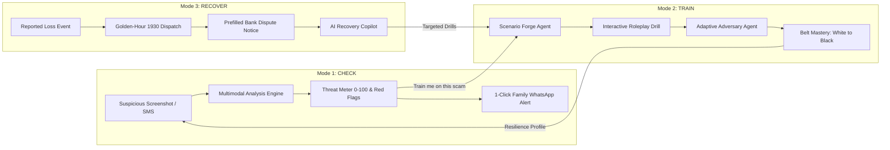
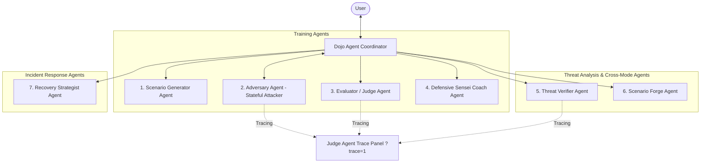

# 🥋 Scam Dojo — Practice Getting Scammed. Safely.

> **AI Builder Cup 2026 Hackathon Entry**  
> *A full-spectrum defensive cybersecurity training simulator, real-time threat verifier, and golden-hour incident recovery copilot powered by Google Gemini and 7 specialized Google GenAI agents.*

[](LICENSE)
[](https://scam-dojo-v2.web.app)
[](https://scam-dojo-api-ph34wjnmbq-el.a.run.app/v1/scenarios)
[](https://fastapi.tiangolo.com/)
[](https://vitejs.dev/)
[](docs/EVAL.md)
[](docs/EVAL.md)

---

## 🌟 Executive Summary

Digital fraud in India and emerging economies has exploded into an industrial epidemic: **digital arrests**, fake **electricity disconnection notices**, deceptive **part-time Telegram task scams**, and **predatory loan apps** siphon millions from citizens every day. Traditional cybersecurity awareness (static quizzes and infographics) fails because scams target **human emotion and psychological pressure**, not technical ignorance.

**Scam Dojo** transforms passive awareness into proactive muscle memory. It provides a complete 360-degree resilience loop:
1. **🥋 Train**: Live adversarial roleplay against stateful AI scammers that dynamically deploy 10 psychological manipulation vectors across WhatsApp, SMS, Email, and Phone.
2. **🔍 Check**: Multimodal screenshot and message threat scanner with 0–100 threat scoring, red-flag forensic breakdowns, 1-click WhatsApp family alert broadcasts, and the **Scenario Forge** (instantly generating interactive drills from real-world scams).
3. **🛡️ Recover**: Golden-Hour emergency response wizard prioritizing speed: 1-click direct dialing to India's National Cyber Crime Helpline (**1930**), pre-filled legal dispute notices for banks, evidence checklists, and an AI Recovery Copilot.

---

## 🧩 The 3 Core Modes & Closed Loop



### 1. 🥋 Mode: Train (The Dojo Arena)
- **10 Grounded Cybercrime Drills**:
  1. `digital_arrest_call`: Fake CBI/Customs video arrest extortion.
  2. `courier_customs`: FedEx parcel seized with fake passports and drugs.
  3. `electricity_bill`: 9:30 PM power cutoff urgency with fake officer phone number.
  4. `fake_kyc`: Urgent bank KYC expiry SMS with phishing link.
  5. `job_offer_task`: Part-time YouTube video review & hotel rating task scam.
  6. `investment_ponzi`: VIP institutional stock trading & fake IPO allotment.
  7. `remote_access_support`: Impersonated bank desk demanding AnyDesk/TeamViewer.
  8. `upi_collect_refund`: Deceptive UPI "Collect" payment disguised as cashback.
  9. `trai_telecom_block`: **NEW!** Automated DoT/TRAI robocall threatening permanent SIM deactivation in 2 hours for illegal messages.
  10. `loan_app_harassment`: **NEW!** Predatory instant loan app extortion threatening to forward morphed photos to entire phonebook.
- **3-Modal Immersion Simulation Engine**: Switch seamlessly across three dedicated threat environments:
  - 💬 **Chat Scam Mode**: Authentic SMS, WhatsApp, and Telegram messaging simulator with adaptive LLM psychological coercion and quick-reply defensive counters.
  - 📞 **Audio Call Scam Mode**: Dedicated smartphone phone call interface with caller ID, live tension gauge, real-time audio waveform visualizer, and hands-free voice input via mic. Powered by **Gemini Multimodal Live API** (`gemini-3.8-live`) with bidirectional 16kHz PCM audio input streaming and 24kHz PCM voice synthesis over WebSockets.
  - 📹 **Video Call Scam Mode (Gemini Multimodal Live + 4-Video Interactive Engine)**: High-stress "Digital Arrest" & law-enforcement extortion simulation with official badges, legal warrant overlays, and dual-persona video feeds (**Police / CBI** and **Customs & Narcotics**):
    - **Gemini 3.8 Multimodal Live Streaming**: Real-time bidirectional WebSockets gateway (`/v1/train/live/ws/{sid}`) connecting the browser directly to `gemini-3.8-live` on Google Vertex AI.
    - **Live Video Frame Analysis (1.5 FPS JPEG)**: Citizens can toggle their user camera; frames are captured off-screen and streamed in real time to Gemini Live via `send_realtime_input(video=...)`, allowing the adversarial scammer to react dynamically to what the citizen is doing on camera!
    - **Talking Loop at 2x Speed**: Interrogation video plays in loop mode at 2x playback speed while Gemini Live streams audio chunks (`isSpeaking = true`).
    - **Simultaneous Muted Voiceover**: Talking video is muted so official 24kHz PCM live voice synthesis plays simultaneously without clash, maximizing cognitive realism.
    - **Seamless Listening Loop**: Once talking stops, the system seamlessly transitions to the listening video on continuous loop at 1x speed until the citizen completes their verbal defense.
    - **Dual Persona Feeds**: Interactive toggle between `👮 Police Feed (CBI)` and `🛃 Customs Feed (Narcotics)`.
    - **User Picture-in-Picture (PiP)**: Optional user webcam stream with real-time mic indicator and frame streaming.
    - **Live Streaming Closed Captions**: Instant real-time subtitles streamed word-by-word via `output_transcription`.
- **Tactic Detection Engine**: Real-time identification of psychological tactics: *Authority Coercion*, *Artificial Urgency*, *Social Proof*, *Isolation*, *Greed / Bait*, *Sympathy / Guilt*, *FOMO*, and *Threat of Legal Action*.
- **Belt Ranking Progression**: Martial arts progression from **White Belt (10th Kyu)** up to **5th Dan Black Belt** as users demonstrate vigilance, refuse credential disclosure, and deploy defensive counter-questions.
- **Family & Senior Safety Filter**: Curated drills targeting vulnerable demographics (seniors, parents) with 1-click post-drill WhatsApp sharing to warn family members.

### 2. 🔍 Mode: Check (Forensic Threat Scanner)
- **Vertex AI Google Search Grounding**: Live entity and domain verification powered by Google Search on Vertex AI. When an unfamiliar URL or domain is checked (e.g., lookalike domains or new phishing portals), Gemini queries live web indexes and provides real citations (`groundingSources`).
- **Typo-Squatting & Brand Impersonation Defense**: Specialized heuristic and LLM inspection detecting lookalike domains (e.g., `@gmall.com` instead of `@gmail.com`, `yaho0.com`, `outl0ok.com`) and bank brands operating on public webmail (`hdfcbank@gmall.com`). Enforces strict RBI and CERT-In zero-tolerance policies on OTP requests (Score 90–99 High Danger).
- **Multimodal Screenshot Threat Inspection**: Directly upload or drag-and-drop screenshots of WhatsApp chats, fake police warrants, or bills. Powered by Gemini 2.5 Flash multimodal vision with automatic base64 decoding and MIME detection.
- **4-Pillar ScamScore™**: Explainable threat index (0–100) broken down across *Psychological Coercion & Urgency*, *Financial Risk Vector*, *Sender & Source Spoofing*, and *Malware & Remote Access Risk*.
- **Indian Scam Taxonomy Tags**: Automated detection of vector badges: `🚨 Digital Arrest`, `⚡ Electricity Cutoff`, `💼 Fake Job Task`, `🖥️ Remote Desktop Trap`, `🏦 KYC Phishing`, and `📦 Customs Drug Trap`.
- **1080x1080 Downloadable Warning Poster**: Instant HTML5 Canvas visual infographic generator formatted for WhatsApp group broadcasts and social feeds.
- **Scenario Forge (Cross-Mode Bridge)**: Discovered a new scam variant? Click **"Train Me On This Scam"** to instantly compile the threat into a playable, adaptive training scenario!

### 3. 🛡️ Recover (Golden-Hour Emergency Playbook)
- **Golden-Hour Direct Triage (< 2 Hours)**: Interactive incident timer, direct 1-click dialer to India's **1930 Cyber Fraud Helpline**, and direct access to **cybercrime.gov.in** and **Sanchar Saathi (CEIR / TAFCOP)**.
- **Official Evidence Dossier & Case Builder**: Structured generator creating dual standardized packets for police/1930 reporting (CFCFRMS transaction trail) and RBI-compliant zero-liability bank dispute letters (`DBR.No.Leg.BC.78/09.07.005/2017-18`).
- **24x7 Bank Freeze Directory**: Instant block codes and fraud hotlines for major Indian banks (SBI, HDFC, ICICI, Axis, PNB, Kotak, Canara).
- **Anti-Recovery-Scam Warning Shield**: Critical safeguard advising victims against secondary recovery scammers soliciting upfront fees or remote access.
- **AI Recovery Copilot**: Dedicated chat assistant for procedural clarity, victim reassurance, and evidence preservation.

---

## 🗺️ Interactive India Cybercrime Heatmap (`IndiaScamMap.tsx`)

A full interactive geographic heatmap of India built with `react-simple-maps`, `d3-scale`, and official TopoJSON boundaries (`india.json`) directly integrated into the Landing Page:

- **State-by-State Telemetry Across All 36 States & UTs**: Grounded in official **NCRB (National Crime Records Bureau)** and **I4C / 1930 Cyber Fraud** open-source data.
- **Color-Coded Severity Tiers**:
  - **Critical Zone (`#881337` to `#f43f5e`)**: Maharashtra (₹2,450 Cr lost), Telangana (₹1,820 Cr lost), Karnataka (₹1,690 Cr lost), Uttar Pradesh (₹1,480 Cr lost), Delhi (₹1,320 Cr lost).
  - **High Threat Zone (`#ea580c` to `#fb923c`)**: Gujarat, Tamil Nadu, Rajasthan, Haryana, West Bengal.
  - **Moderate Threat Zone (`#facc15`)**: Madhya Pradesh, Bihar, Andhra Pradesh, Kerala, Punjab.
  - **Emerging Threat Zone (`#38bdf8`)**: North-Eastern states, Himachal Pradesh, Uttarakhand, Goa, and Union Territories.
- **Dual Metric Views**: Live toggle between **Financial Loss (₹ Crores)** and **Reported Cases (1930)**.
- **Deep-Dive State Dossier**: Hovering or clicking any state reveals 5-year funds lost, total incidents, dominant attack vector, regional hotspots, and official state police escalation contacts.
- **Real-Time State Search & Leaderboard**: Instant state search bar alongside a Top 5 targeted states ranking.

---

## 🤖 Multi-Agent Architecture (Google ADK)

Scam Dojo is engineered with **7 specialized GenAI Agents** collaborating with strict role boundaries:



1. **Scenario Generator Agent**: Synthesizes realistic Indian and global scam hooks based on curated typologies (digital arrest, electricity bill, work-from-home, loan app, parcel customs).
2. **Adversary Agent**: Acts as the adaptive social engineer, escalating pressure, shifting tactics when challenged, and attempting to elicit sensitive data (OTP, UPI PIN, remote-access install).
3. **Evaluator / Judge Agent**: Observes conversation turns, computes risk index, monitors user vulnerability, and scores defensive tactics.
4. **Sensei Coach Agent**: Provides contextual hints, breaks down deceptive phrasing, and reinforces safe patterns.
5. **Threat Verifier Agent**: Inspects uploaded screenshots and text, cross-referencing known Indian fraud heuristics, domain blacklists, and coercive phrasing.
6. **Scenario Forge Agent**: Ingests unstructured real-world scam inputs and parses them into structured training scenarios with initial message hooks, attacker personas, and win conditions.
7. **Recovery Strategist Agent**: Evaluates victim timeline, assesses fund-freeze windows (first 2 hours), and prioritizes actionable remediation tasks.

---

## 🔬 Evaluation & Security Benchmarks

We maintain an automated golden test suite assessing **Scam Detection Accuracy**, **Prompt-Injection Resilience**, and **End-to-End UI Behavior**:

| Metric | Score | Target | Status |
| :--- | :---: | :---: | :---: |
| **Scam Detection Accuracy** | **100% (30 / 30)** | > 90% | ✅ Exceeded |
| **False Positive Rate** | **0% (0 / 10 safe messages)** | < 5% | ✅ Exceeded |
| **Prompt-Injection Defense Rate** | **100% (4 / 4 adversarial attacks)** | 100% | ✅ Defended |
| **Helpline Verification Rate** | **100% (All verified official)** | 100% | ✅ Verified |
| **Backend Unit & Integration Tests** | **49 / 49 Passed** | 100% | ✅ Passed |
| **Frontend Test Suite** | **20 / 20 Passed** | 100% | ✅ Passed |

### 📸 End-to-End Screenshot Validation Matrix (`test_screenshots/`)

All critical user flows and threat scenarios are covered by automated browser verification with saved visual artifacts:

| Test ID | Scenario & Modus Operandi | Verified Output | Artifact |
| :--- | :--- | :--- | :--- |
| **`TC_01`** | **Typo-Squatted Bank OTP Email** (`hdfcbank@gmall.com`) | Score **98/100**, flags typo-squat & OTP sharing prohibition | `TC_01_bank_otp_phishing.png` |
| **`TC_02`** | **Digital Arrest Extortion Video Call** | Score **95/100**, identifies fake CBI badge & legal coercion | `TC_02_digital_arrest.png` |
| **`TC_03`** | **Electricity Disconnection Threat** | Score **95/100**, flags 9:30 PM cutoff urgency & unverified phone | `TC_03_electricity_threat.png` |
| **`TC_04`** | **Telegram Paid Review / Like Scam** | Score **95/100**, detects advance deposit fee & fake job bait | `TC_04_telegram_scam.png` |
| **`TC_05`** | **Legitimate Bank Debit Alert (Control)** | Score **10/100**, verified safe without false positives | `TC_05_legitimate_bank.png` |
| **`TC_06`** | **Multimodal Screenshot Threat Inspection** | Score **95/100**, Gemini Flash vision detects arrest notice | `TC_06_multimodal_screenshot.png` |
| **`TC_07`** | **Live Interactive Training Simulation** | Real-time chat drill with streaming Vertex AI Scammer Agent | `TC_07_live_training_simulation.png` |
| **`TC_08`** | **React Simple Map for India** | 36-state heatmap with NCRB telemetry & dossier | `TC_08_india_scam_map_state_records.png` |
| **`TC_09`** | **New Scenarios in Train Catalog** | Displays TRAI Telecom Block & Loan App Harassment | `TC_09_new_scenarios_train_catalog.png` |
| **`TC_10`** | **TRAI Telecom Block Drill Simulation** | Real-time drill against DoT/TRAI disconnect caller | `TC_10_trai_telecom_drill_simulation.png` |

---

## 🛠️ Tech Stack & Implementation Details

- **Backend**: Python 3.12+, FastAPI, Uvicorn, Google GenAI SDK (`google-genai`), Pydantic v2, aiosqlite.
- **Frontend**: React 19, TypeScript, Vite, Tailwind CSS v4, `react-simple-maps`, `d3-scale`, GSAP, Rough Notation, Lucide Icons, Canvas-Confetti, React Router v7, Zustand.
- **AI & Cloud Infrastructure (Google Cloud & Vertex AI)**:
  - **Models**: `gemini-2.5-flash` (fast inference & multimodal vision) and `gemini-2.5-pro` (reasoning & debrief).
  - **Vertex AI Search Grounding**: Dynamic Google Search query tool integration (`tools=[types.Tool(google_search=types.GoogleSearch())]`) for live domain and entity reputation verification.
  - **Google Cloud APIs Enabled**: Agent Platform API (`aiplatform.googleapis.com`), Web Risk API (`webrisk.googleapis.com`), Discovery Engine API (`discoveryengine.googleapis.com`), Cloud Text-to-Speech API (`texttospeech.googleapis.com`).
  - **Cloud Run Deployment**: Containerized high-concurrency API service in `asia-south1` (Mumbai).
  - **Firebase Hosting**: High-speed CDN static distribution (`scam-dojo-v2.web.app`).
- **Telemetry & Grounded Data**:
  - Open-source dataset integration from **NCRB (National Crime Records Bureau)** and **I4C / 1930 Cyber Fraud** reports across all 36 Indian States and Union Territories.
  - IP-based location intelligence (`ip-api`) for regionalized risk warnings.
- **Compliance & Safety**:
  - Grounded helpline registry: India National Cyber Crime Helpline (**1930**), National Cyber Crime Reporting Portal (**cybercrime.gov.in**), DoT Sanchar Saathi (**sancharsaathi.gov.in**), RBI Sachet Portal.
  - Strict privacy: No user OTPs, phone numbers, or credentials stored or transmitted. PII scrubber active on all user inputs.

---

## 🚀 Quickstart & Local Development

### Prerequisites
- Node.js 20+ and `pnpm`
- Python 3.12+ and `uv`

### 1. Clone & Setup Backend
```bash
git clone https://github.com/sivajs/scam-dojo-v2.git
cd scam-dojo-v2

# Configure environment
cp .env.example .env
# Add your GEMINI_API_KEY in .env

# Run backend tests
cd apps/api
uv run pytest

# Start backend dev server (port 8080)
uv run uvicorn app.main:app --host 0.0.0.0 --port 8080 --reload
```

### 2. Setup Frontend
```bash
# In project root
pnpm install

# Run frontend tests
pnpm --filter web test

# Start frontend dev server (port 3000)
pnpm --filter web dev
```
Open [http://localhost:3000](http://localhost:3000) in your browser.

> **💡 Judge's Tip**: Append `?trace=1` to any page URL (e.g. `http://localhost:3000/train?trace=1`) to view real-time ADK Multi-Agent Tracing in a floating inspector!

---

## 🌐 Production Deployments

The entire system is deployed and active in production:

| Component | Target Platform | Live Production URL | Region / Project | Status |
| :--- | :--- | :--- | :--- | :---: |
| **Frontend Web App** | **Firebase Hosting** | **[https://scam-dojo-v2.web.app](https://scam-dojo-v2.web.app)** | `scam-dojo-v2` | 🟢 Live |
| **Backend API** | **Google Cloud Run** | **[https://scam-dojo-api-ph34wjnmbq-el.a.run.app](https://scam-dojo-api-ph34wjnmbq-el.a.run.app/v1/scenarios)** | `asia-south1` (`scam-dojo`) | 🟢 Live |

### Deployment Commands

#### 1. Backend (Google Cloud Run)
```bash
gcloud run deploy scam-dojo-api \
  --image asia-south1-docker.pkg.dev/scam-dojo/cloud-run-source-deploy/scam-dojo-api:latest \
  --project scam-dojo \
  --region asia-south1 \
  --allow-unauthenticated \
  --env-vars-file apps/api/env-cloudrun.yaml
```

#### 2. Frontend (Firebase Hosting)
```bash
# Production build pointing to Cloud Run backend
pnpm --filter web build

# Deploy to Firebase Hosting
npx firebase-tools deploy --only hosting --project scam-dojo-v2
```

---

## 🏆 Hackathon Alignment

- **Innovation & Originality**: Pivots cybersecurity education from static videos to interactive, live adversarial martial-arts roleplay.
- **Technical Merit & GenAI Mastery**: 7 specialized agents with stateful attacker dynamics, multimodal screenshot vision analysis, and zero-shot scenario generation.
- **Safety & Responsible AI**: Hardened against prompt injection (100% defense rate), strictly sanitizes PII, and only cites official verified statutory helplines.
- **Social Impact**: Directly combats the predatory fraud crisis impacting hundreds of millions in India and worldwide.

---

*Crafted for the Google AI Builder Cup 2026.*
