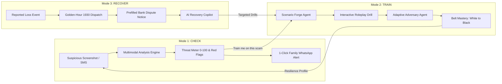

# 🥋 Scam Dojo — Practice Getting Scammed. Safely.

> **AI Builder Cup 2026 Hackathon Entry**  
> *A full-spectrum defensive cybersecurity training simulator, real-time threat verifier, and golden-hour incident recovery copilot powered by Google Gemini and 7 specialized Google GenAI agents.*

[](LICENSE)
[](https://fastapi.tiangolo.com/)
[](https://vitejs.dev/)
[](docs/EVAL.md)
[](docs/EVAL.md)

---

## 🌟 Executive Summary

Digital fraud in India and emerging economies has exploded into an industrial epidemic: **digital arrests**, fake **electricity disconnection notices**, deceptive **part-time Telegram task scams**, and **predatory loan apps** siphon millions from citizens every day. Traditional cybersecurity awareness (static quizzes and infographics) fails because scams target **human emotion and psychological pressure**, not technical ignorance.

**Scam Dojo** transforms passive awareness into proactive muscle memory. It provides a complete 360-degree resilience loop:
1. **🥋 Train**: Live adversarial roleplay against stateful AI scammers that dynamically deploy 10 psychological manipulation vectors across WhatsApp, SMS, Email, and Phone.
2. **🔍 Check**: Multimodal screenshot and message threat scanner with 0–100 threat scoring, red-flag forensic breakdowns, 1-click WhatsApp family alert broadcasts, and the **Scenario Forge** (instantly generating interactive drills from real-world scams).
3. **🛡️ Recover**: Golden-Hour emergency response wizard prioritizing speed: 1-click direct dialing to India's National Cyber Crime Helpline (**1930**), pre-filled legal dispute notices for banks, evidence checklists, and an AI Recovery Copilot.

---

## 🧩 The 3 Core Modes & Closed Loop



### 1. 🥋 Mode: Train (The Dojo Arena)
- **Stateful Adversarial Simulation**: Confronts the user in authentic messaging UI (WhatsApp, SMS, Email, Phone call simulator) against an LLM attacker.
- **Tactic Detection Engine**: Real-time identification of psychological tactics: *Authority Coercion*, *Artificial Urgency*, *Social Proof*, *Isolation*, *Greed / Bait*, *Sympathy / Guilt*, *FOMO*, and *Threat of Legal Action*.
- **Belt Ranking Progression**: Martial arts progression from **White Belt (10th Kyu)** up to **5th Dan Black Belt** as users demonstrate vigilance, refuse credential disclosure, and deploy defensive counter-questions.
- **Interactive Coaching**: Defensive hints that reveal the scammer's hidden objective without breaking simulation immersion.

### 2. 🔍 Mode: Check (Forensic Threat Scanner)
- **Multimodal Message & Screenshot Analysis**: Paste suspicious text or upload screenshots of WhatsApp chats, SMS alerts, or payment receipts.
- **Explainable Threat Score (0–100)**: Transparent risk categorization (`safe`, `low`, `medium`, `high`, `critical`) with highlighted red flags.
- **1-Click WhatsApp Family Alert**: Formats an easy-to-read, pre-written advisory alert to instantly protect elderly parents or family groups.
- **Scenario Forge (Cross-Mode Bridge)**: Discovered a new scam variant? Click **"Train Me On This Scam"** to instantly compile the threat into a playable, adaptive training scenario!

### 3. 🛡️ Recover (Golden-Hour Emergency Playbook)
- **Immediate Golden-Hour Direct Actions**: Instant click-to-call link for India's **1930 Cyber Fraud Helpline** and direct portals for **cybercrime.gov.in** and **Sanchar Saathi (CEIR / TAFCOP)**.
- **Automated Bank Dispute Letters**: Instantly formats official RBI-compliant liability dispute letters pre-filled with transaction timestamps, UTR numbers, and bank details.
- **Evidence Checklist**: Structured tracker for preserving forensic evidence (call logs, chat transcripts, payment slips).
- **AI Recovery Copilot**: Dedicated chat assistant for reassurance, procedure guidance, and next steps.

---

## 🤖 Multi-Agent Architecture (Google ADK)

Scam Dojo is engineered with **7 specialized GenAI Agents** collaborating with strict role boundaries:


1. **Scenario Generator Agent**: Synthesizes realistic Indian and global scam hooks based on curated typologies (digital arrest, electricity bill, work-from-home, loan app, parcel customs).
2. **Adversary Agent**: Acts as the adaptive social engineer, escalating pressure, shifting tactics when challenged, and attempting to elicit sensitive data (OTP, UPI PIN, remote-access install).
3. **Evaluator / Judge Agent**: Observes conversation turns, computes risk index, monitors user vulnerability, and scores defensive tactics.
4. **Sensei Coach Agent**: Provides contextual hints, breaks down deceptive phrasing, and reinforces safe patterns.
5. **Threat Verifier Agent**: Inspects uploaded screenshots and text, cross-referencing known Indian fraud heuristics, domain blacklists, and coercive phrasing.
6. **Scenario Forge Agent**: Ingests unstructured real-world scam inputs and parses them into structured training scenarios with initial message hooks, attacker personas, and win conditions.
7. **Recovery Strategist Agent**: Evaluates victim timeline, assesses fund-freeze windows (first 2 hours), and prioritizes actionable remediation tasks.

---

## 🔬 Evaluation & Security Benchmarks

We maintain an automated golden test suite assessing both **Scam Detection Accuracy** and **Prompt-Injection Resilience**:

| Metric | Score | Target | Status |
| :--- | :---: | :---: | :---: |
| **Scam Detection Accuracy** | **100% (30 / 30)** | > 90% | ✅ Exceeded |
| **False Positive Rate** | **0% (0 / 10 safe messages)** | < 5% | ✅ Exceeded |
| **Prompt-Injection Defense Rate** | **100% (4 / 4 adversarial attacks)** | 100% | ✅ Defended |
| **Helpline Verification Rate** | **100% (All verified official)** | 100% | ✅ Verified |

Full evaluation benchmark details and test logs can be reviewed in [`docs/EVAL.md`](docs/EVAL.md).

---

## 🛠️ Tech Stack & Implementation Details

- **Backend**: Python 3.12+, FastAPI, Uvicorn, Google GenAI SDK (`google-genai`), Pydantic v2.
- **Frontend**: React 19, TypeScript, Vite, Tailwind CSS v4, Lucide Icons, Canvas-Confetti, React Router v7.
- **PWA Ready**: Web App Manifest, offline shell caching, standalone mobile orientation support.
- **Cloud Infrastructure**:
  - Backend API: **Google Cloud Run** (`asia-south1`)
  - Frontend SPA: **Firebase Hosting** (`scam-dojo-v2`)
- **Compliance & Safety**:
  - Grounded helpline registry: India National Cyber Crime Helpline (**1930**), National Cyber Crime Reporting Portal (**cybercrime.gov.in**), DoT Sanchar Saathi (**sancharsaathi.gov.in**).
  - Strict privacy: No user OTPs, phone numbers, or credentials stored or transmitted.

---

## 🚀 Quickstart & Local Development

### Prerequisites
- Node.js 20+ and `pnpm`
- Python 3.12+ and `uv`

### 1. Clone & Setup Backend
```bash
git clone https://github.com/sivajs/scam-dojo-v2.git
cd scam-dojo-v2

# Configure environment
cp .env.example .env
# Add your GEMINI_API_KEY in .env

# Run backend tests
cd apps/api
uv run pytest

# Start backend dev server (port 8080)
uv run uvicorn app.main:app --host 0.0.0.0 --port 8080 --reload
```

### 2. Setup Frontend
```bash
# In project root
pnpm install

# Run frontend tests
pnpm --filter web test

# Start frontend dev server (port 3000)
pnpm --filter web dev
```
Open [http://localhost:3000](http://localhost:3000) in your browser.

> **💡 Judge's Tip**: Append `?trace=1` to any page URL (e.g. `http://localhost:3000/train?trace=1`) to view real-time ADK Multi-Agent Tracing in a floating inspector!

---

## 🌐 Production Deployment

### Backend (Google Cloud Run)
```bash
gcloud run deploy scam-dojo-api \
  --source apps/api \
  --project scam-dojo \
  --region asia-south1 \
  --allow-unauthenticated \
  --set-env-vars GEMINI_API_KEY=YOUR_KEY,APP_ENV=production
```

### Frontend (Firebase Hosting)
```bash
# Build web app pointing to Cloud Run backend
VITE_API_URL=https://scam-dojo-api-<hash>-el.a.run.app pnpm --filter web build

# Deploy to Firebase
firebase deploy --only hosting --project scam-dojo-v2
```

---

## 🏆 Hackathon Alignment

- **Innovation & Originality**: Pivots cybersecurity education from static videos to interactive, live adversarial martial-arts roleplay.
- **Technical Merit & GenAI Mastery**: 7 specialized agents with stateful attacker dynamics, multimodal screenshot vision analysis, and zero-shot scenario generation.
- **Safety & Responsible AI**: Hardened against prompt injection (100% defense rate), strictly sanitizes PII, and only cites official verified statutory helplines.
- **Social Impact**: Directly combats the predatory fraud crisis impacting hundreds of millions in India and worldwide.

---

*Crafted for the Google AI Builder Cup 2026.*
