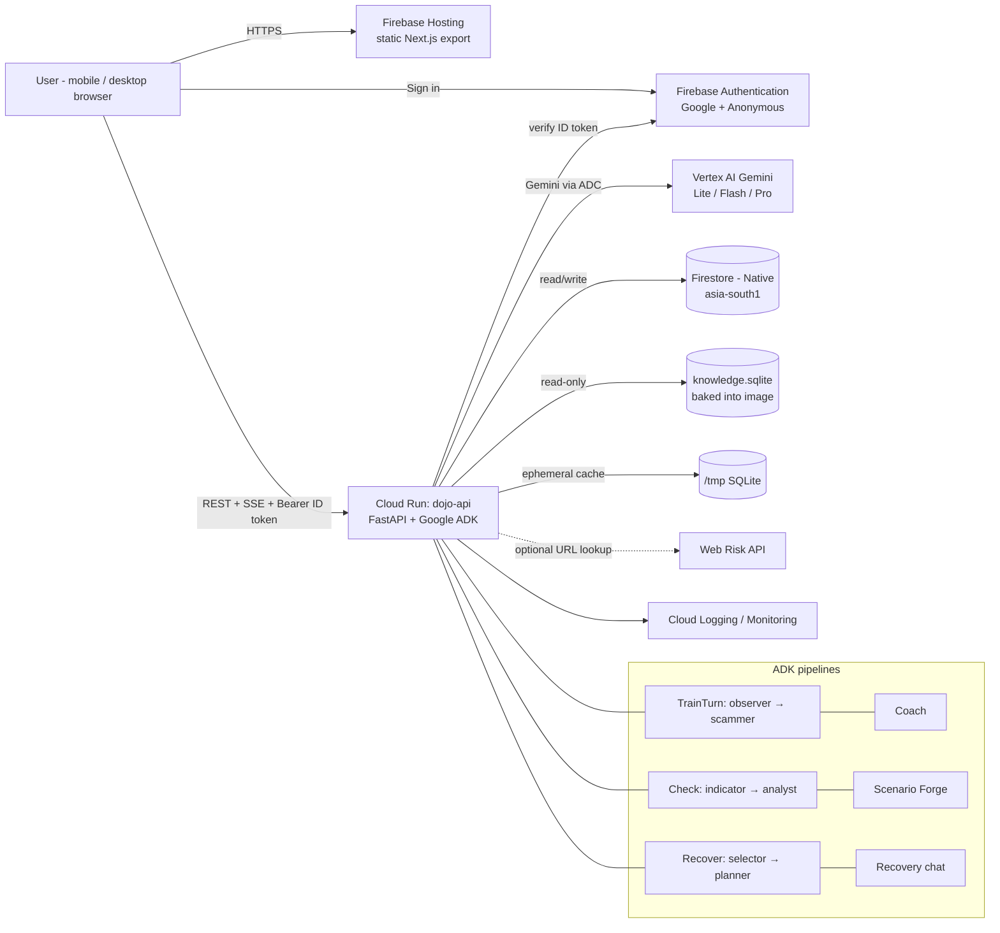

# 7. Infrastructure & Deployment (Google Cloud + Firebase)

## 1. Architecture


Include this diagram (rendered PNG + mermaid source) in the README and the pitch deck.

---

## 2. Project bootstrap (`infra/scripts/gcp-bootstrap.sh`)

Variables: `PROJECT_ID`, `REGION=asia-south1`, `API_SERVICE=dojo-api`, `SA=dojo-api`.

```bash
gcloud config set project $PROJECT_ID

# APIs
gcloud services enable run.googleapis.com artifactregistry.googleapis.com cloudbuild.googleapis.com \
  firestore.googleapis.com aiplatform.googleapis.com identitytoolkit.googleapis.com firebase.googleapis.com \
  firebasehosting.googleapis.com secretmanager.googleapis.com cloudscheduler.googleapis.com \
  monitoring.googleapis.com logging.googleapis.com webrisk.googleapis.com   # webrisk only if used

# Firestore (Native) — location is permanent
gcloud firestore databases create --location=$REGION --type=firestore-native

# Artifact Registry
gcloud artifacts repositories create dojo --repository-format=docker --location=$REGION

# Runtime service account (no JSON keys, ever)
gcloud iam service-accounts create $SA --display-name="Scam Dojo API"
for ROLE in roles/aiplatform.user roles/datastore.user roles/logging.logWriter roles/monitoring.metricWriter; do
  gcloud projects add-iam-policy-binding $PROJECT_ID \
    --member="serviceAccount:$SA@$PROJECT_ID.iam.gserviceaccount.com" --role=$ROLE
done
# Only if "Delete account" removes the Firebase Auth user:
# gcloud projects add-iam-policy-binding $PROJECT_ID --member="serviceAccount:$SA@..." --role=roles/firebaseauth.admin
```
Firebase (console or CLI): add Firebase to the GCP project → create a **Web app** → enable **Google** and **Anonymous** sign-in providers → add authorised domains (`<project>.web.app`, `<project>.firebaseapp.com`, custom domain, `localhost`).

**Gemini on Vertex AI:** confirm the chosen model IDs are served in your `GOOGLE_CLOUD_LOCATION` (some models are only served in specific regions or via the `global` location). If Mumbai doesn't serve a model you need, set the Vertex location separately from the Cloud Run region — latency impact is small relative to generation time. **Record the decision in `docs/DECISIONS.md`.** Check Vertex quotas (requests per minute per model) for the demo day and request an increase if needed.

---

## 3. API container (`apps/api/Dockerfile`)

```dockerfile
FROM python:3.12-slim AS base
ENV PYTHONUNBUFFERED=1 PIP_NO_CACHE_DIR=1 PORT=8080
WORKDIR /srv
RUN apt-get update && apt-get install -y --no-install-recommends ffmpeg && rm -rf /var/lib/apt/lists/*   # ffprobe for media duration
COPY apps/api/requirements.lock .
RUN pip install -r requirements.lock
COPY apps/api/app ./app
COPY data/knowledge.sqlite ./data/knowledge.sqlite
ENV KB_PATH=/srv/data/knowledge.sqlite
RUN useradd -m app && chown -R app /srv
USER app
CMD ["sh", "-c", "uvicorn app.main:app --host 0.0.0.0 --port ${PORT} --workers 1 --timeout-keep-alive 75"]
```
Build context is the repo root. Add `.dockerignore` (node_modules, .git, .env*, apps/web, tests, evals).

## 4. Deploy the API (`infra/scripts/deploy-api.sh`)

```bash
IMAGE=$REGION-docker.pkg.dev/$PROJECT_ID/dojo/api:$(git rev-parse --short HEAD)
gcloud builds submit --tag $IMAGE -f apps/api/Dockerfile .      # or docker build/push

gcloud run deploy dojo-api --image $IMAGE --region $REGION \
  --service-account dojo-api@$PROJECT_ID.iam.gserviceaccount.com \
  --allow-unauthenticated \                                       # app-level Firebase token auth
  --cpu 2 --memory 1Gi --concurrency 40 --timeout 300 \
  --min-instances 1 --max-instances 10 --cpu-boost \
  --set-env-vars ENV=prod,STORE=firestore,AUTH_MODE=firebase,GOOGLE_GENAI_USE_VERTEXAI=TRUE,\
GOOGLE_CLOUD_PROJECT=$PROJECT_ID,GOOGLE_CLOUD_LOCATION=$VERTEX_LOCATION,FIREBASE_PROJECT_ID=$PROJECT_ID,\
MODEL_LITE=$MODEL_LITE,MODEL_FAST=$MODEL_FAST,MODEL_PRO=$MODEL_PRO,MODEL_FALLBACK=$MODEL_FALLBACK,\
CORS_ORIGINS=https://$PROJECT_ID.web.app,TRACE_ENABLED=true,DEMO_MODE=off
```
Notes:
- `--min-instances 1` for the event window (removes cold starts), set back to `0` afterwards.
- Streaming works on Cloud Run; keep `--timeout` ≥ 120 to cover Coach/Planner.
- Secrets (if any, e.g. a Web Risk API key): Secret Manager + `--set-secrets`. Prefer ADC where supported.
- Print the service URL and write it to `apps/web/.env.production` as `NEXT_PUBLIC_API_URL`.

## 5. Deploy the web app (`infra/scripts/deploy-web.sh`)
```bash
cd apps/web && pnpm install --frozen-lockfile && pnpm build   # next.config: output 'export' → ./out
cd ../.. && firebase deploy --only hosting,firestore:rules,firestore:indexes --project $PROJECT_ID
```

`firebase/firebase.json`
```json
{
  "hosting": {
    "public": "apps/web/out",
    "cleanUrls": true,
    "trailingSlash": false,
    "ignore": ["firebase.json", "**/.*", "**/node_modules/**"],
    "headers": [
      { "source": "**/*.@(js|css|woff2|svg|png|webp|ico)", "headers": [{ "key": "Cache-Control", "value": "public,max-age=31536000,immutable" }] },
      { "source": "**/*.html", "headers": [{ "key": "Cache-Control", "value": "no-cache" }] },
      { "source": "**", "headers": [
        { "key": "X-Content-Type-Options", "value": "nosniff" },
        { "key": "Referrer-Policy", "value": "strict-origin-when-cross-origin" },
        { "key": "Permissions-Policy", "value": "camera=(), microphone=(self), geolocation=()" },
        { "key": "Content-Security-Policy", "value": "default-src 'self'; script-src 'self' 'unsafe-inline' https://apis.google.com; style-src 'self' 'unsafe-inline'; img-src 'self' data: blob: https://*.googleusercontent.com; font-src 'self' data:; connect-src 'self' https://*.run.app https://*.googleapis.com https://identitytoolkit.googleapis.com https://securetoken.googleapis.com; frame-src https://*.firebaseapp.com https://accounts.google.com; media-src 'self' blob:; object-src 'none'; base-uri 'self'" }
      ]}
    ]
  },
  "firestore": { "rules": "firebase/firestore.rules", "indexes": "firebase/firestore.indexes.json" }
}
```
The CSP above is a **starting point — test the full sign-in + upload + SSE flow in a production build and adjust** (Google Fonts via `next/font` are self-hosted at build time, so `fonts.googleapis.com` is not needed).

## 6. CI/CD (SHOULD)
GitHub Actions `deploy.yml` on `main`:
1. Job `test`: backend (`ruff`, `mypy`, `pytest`), frontend (`pnpm lint`, `tsc`, `vitest`), KB freshness check, OpenAPI snapshot, i18n key parity.
2. Job `deploy-api`: auth with **Workload Identity Federation** (no stored keys) → build → `gcloud run deploy`.
3. Job `deploy-web`: `pnpm build` → `firebase deploy` with a service account via WIF.
4. Job `e2e` (post-deploy smoke): `scripts/smoke.sh` hitting `/readyz`, creating a guest session through the dev-token endpoint is **not** allowed in prod, so the smoke uses a dedicated Firebase test user via the Auth REST API stored in GitHub secrets (SHOULD) — otherwise run smoke manually and note in `docs/SMOKE.md`.
If CI/CD would eat >1 hour, skip it and use the two deploy scripts; document in `docs/DECISIONS.md`.

## 7. Security hardening
- **CORS** allow-list only the Hosting domains + localhost in non-prod.
- **Firebase App Check** (SHOULD): enable with reCAPTCHA Enterprise/v3 provider on web; backend verifies `X-Firebase-AppCheck` when `APP_CHECK_ENFORCE=true` (start in monitor mode, enforce once stable). Reduces scripted abuse of the Gemini-backed API.
- **Rate limits** per-user/day + burst (backend §5.6) and **Vertex quotas/budget alerts** as a second wall.
- No service account keys; least-privilege roles listed above; Artifact Registry private.
- Upload safety: magic-byte validation, memory-only handling, size/duration caps.
- Dependency scanning: `pip-audit`, `pnpm audit` in CI (non-blocking warning).
- HTTPS only; HSTS is on by default in Firebase Hosting.
- Don't log PII or bodies; scrub `Authorization` headers from logs.

## 8. Observability
- Structured logs → Cloud Logging. Log-based metrics: `agent_latency_ms{agent}`, `agent_fallback_count`, `validation_repair_count`, `model_error_count`.
- Uptime check on `GET /readyz` (every 1 min) + alert policy on uptime failure and on Cloud Run 5xx rate > 2% for 5 min → email.
- A simple **ops page** for the team (not public): Cloud Monitoring dashboard with request count, p50/p95 latency, instance count, error rate, Vertex requests.

## 9. Cost & quota guardrails
- Create a **billing budget with alerts** at 50/90/100% (`gcloud billing budgets create ...` or console) before inviting judges.
- Keep models tiered (Lite for referee, Flash for chat/analysis, Pro only for debrief/plan). Cap output tokens (see agents §2.6). Per-user daily limits default as in config.
- Don't claim cost numbers in the pitch unless computed from current pricing pages; if desired, add a short "Cost per drill" estimate computed from logged token counts.

## 10. Environments
| Env | Frontend | API | Store | Auth |
|---|---|---|---|---|
| local | `localhost:3000` | `localhost:8080` | SQLite | dev header or Firebase emulator |
| prod | Firebase Hosting | Cloud Run `dojo-api` | Firestore | Firebase Auth |
A separate `staging` project is optional; otherwise use a Cloud Run revision with `--no-traffic --tag staging` for pre-release checks.

## 11. Rollback & runbook
- **Rollback:** `gcloud run services update-traffic dojo-api --to-revisions <prev>=100`. Hosting: `firebase hosting:rollback` (or redeploy previous build).
- **Event-day runbook (T-60 min):**
  1. `min-instances=1`, verify `/readyz`.
  2. Run `scripts/smoke.sh` (Train 3 turns, Check text + image, Recover wizard) in English and Hindi.
  3. Check Vertex quota headroom and billing budget status.
  4. Warm the demo account (`seed_demo_user.py`) and open `/demo`.
  5. Set `DEMO_MODE=cached` **only if** network at venue is unreliable; otherwise `off`.
  6. Have the backup video open in a local player.
- **If models fail on stage:** toggle `DEMO_MODE=cached` (env update takes ~1 min) or switch to the recorded video.

## 12. Infra acceptance checklist
- [ ] API reachable at Cloud Run URL; `/readyz` green; logs structured.
- [ ] Web reachable at Firebase Hosting URL; guest + Google sign-in work in prod.
- [ ] No service account JSON keys exist anywhere; rules deployed; budget alert active.
- [ ] CORS correct (no `*`); CSP doesn't break Auth/Upload/SSE.
- [ ] Rollback tested once.
